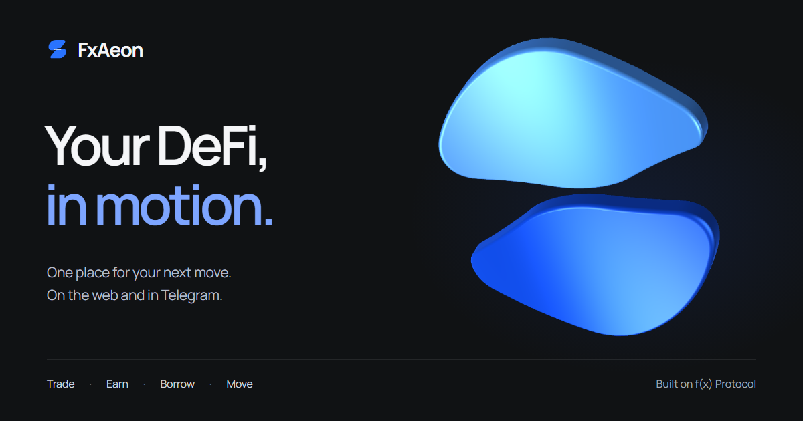

<p align="center">
  <a href="https://fxaeon.com"></a>
</p>

<h1 align="center">FxAeon</h1>

<p align="center">A self-custodial web app and Telegram Mini App for f(x) Protocol.</p>

<p align="center">
  <a href="https://fxaeon.com"><strong>Open the app</strong></a> ·
  <a href="https://t.me/FxAeonBot">Launch in Telegram</a> ·
  <a href="https://fxaeon.xyz">Visit the website</a> ·
  <a href="https://fxaeon.com/docs">Product guide</a> ·
  <a href="docs/README.md">Developer handbook</a>
</p>

<p align="center">
  <a href="https://github.com/fxaeon/FxAeon/actions/workflows/ci.yml"></a>
  <a href="LICENSE"></a>
</p>

## Explore FxAeon

| Product | What it does |
| --- | --- |
| [Trade](https://fxaeon.com/trade) | Open and manage supported ETH and BTC leveraged positions. |
| [Earn](https://fxaeon.com/earn) | Deposit into fxSAVE and choose an available redemption or withdrawal path. |
| [Borrow](https://fxaeon.com/borrow) | Supply supported collateral, borrow fxUSD, repay, or withdraw collateral. |
| [Move](https://fxaeon.com/move) | Bridge fxUSD and fxSAVE between Ethereum and Base, with source and destination status shown separately. |
| [Portfolio](https://fxaeon.com/portfolio) · [History](https://fxaeon.com/history) | Review balances, positions, activity, and receipt-backed recovery information. |

Positions, borrowing, and fxSAVE accounting use Ethereum. Base is supported for selected Move routes; it is not a second positions ledger. See [product behavior](docs/product-behavior.md) for supported routes and limitations.

## Run the app

Use **Node.js 22** and **pnpm 11.19.0**, pinned in the root `package.json`.

```sh
corepack enable
corepack prepare pnpm@11.19.0 --activate
pnpm install --frozen-lockfile
pnpm dev
```

Open [localhost:3000](http://localhost:3000). Public pages and unavailable-data states work without credentials. For protocol reads and wallet-provider setup, follow [local setup](SETUP.md).

The independent landing site runs with `pnpm build:landing` followed by `pnpm preview:landing`; it serves at [localhost:4173](http://localhost:4173). See the [landing package guide](apps/landing/README.md).

## Work on the code

Start with the focused check for your change, then run the release verification before a release candidate:

```sh
pnpm test
pnpm typecheck
pnpm lint
pnpm verify
```

`pnpm verify` runs the repository's configured source, dependency, build, bundle, secret, browser, and landing checks. Browser gates use deterministic or credential-free fixtures; protected Anvil tests run separately against disposable local forks. Choose the relevant suite in the [testing guide](docs/testing.md) and [browser gate map](docs/browser-test-gates.md).

## Architecture and safety

The financial app is a static Next.js export. The selected user wallet signs transactions; FxAeon has no transaction backend, delegated signer, private-key input, or background executor. The reviewed, pinned [f(x) SDK surface](fx-scope.lock.json) plans supported actions; reviews bind terms to the current wallet and inputs, and dependent steps require verified receipts.

Prices, charts, and portfolio estimates are display context. They do not set signing amounts or protocol limits. Missing or stale data stays unavailable. Two separate read-only Pages Functions serve optional [gas quotes](functions/api/gas.ts) and [landing market data](apps/landing/functions/api/market-data.ts).

This is unaudited application software for financial transactions. Inspect each wallet request and read the [security model](docs/security.md) and [vulnerability reporting policy](SECURITY.md).

## Developer handbook

| If you are... | Start here |
| --- | --- |
| Setting up a checkout | [Local setup](SETUP.md) |
| Finding the owner of a feature | [Architecture](docs/architecture.md) and [repository map](docs/README.md#applications) |
| Changing a protocol or signing path | [SDK scope](docs/sdk-scope.md), [security model](docs/security.md), and [contributing](CONTRIBUTING.md) |
| Choosing tests or documenting evidence | [Testing](docs/testing.md) and [browser gates](docs/browser-test-gates.md) |
| Preparing or diagnosing a release | [Deployment](docs/deployment.md) and [release checklist](docs/launch-readiness.md) |
| Updating shared visual patterns | [Design system](DESIGN.md) |

The [developer handbook](docs/README.md) links the implementation guides, package references, and operational boundaries.

## Repository map

| Path | Contents |
| --- | --- |
| [`apps/mini-app`](apps/mini-app/README.md) | Financial app, wallet adapters, SDK integration, and browser harnesses |
| [`apps/landing`](apps/landing/README.md) | Independent marketing site and display-only market data |
| [`functions`](functions) | Optional app gas Pages Function |
| [`docs`](docs/README.md) | Maintained developer handbook and implementation references |
| [`scripts`](scripts) | Verification, build, deployment, and capture tools |
| [`patches`](patches) | Version-bound dependency patches |

[Contributing](CONTRIBUTING.md) · [MIT License](LICENSE)
