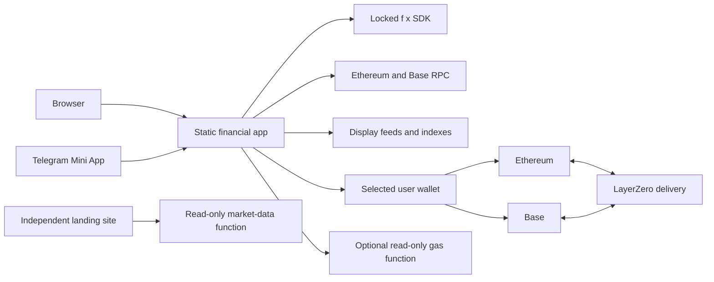

# Architecture

FxAeon has two independently deployed applications: a static financial client for web and Telegram, and a static marketing site. Two small read-only Pages Functions provide gas and landing market data. There is no FxAeon transaction server or account database.

## System map

Ethereum is authoritative for positions, borrowing, and fxSAVE accounting. Move supports reviewed fxUSD/fxSAVE transfers between Ethereum and Base. Base is not a second positions or vault ledger.

## Ownership and entry points

Paths below are relative to `apps/mini-app/src/`.

| Responsibility | Owning code | Boundary |
| --- | --- | --- |
| Route-level provider loading | [RouteProviders](../apps/mini-app/src/components/RouteProviders.tsx), [ProductProviders](../apps/mini-app/src/components/ProductProviders.tsx) | A docs-only visit can avoid the product provider graph |
| Wallet-mode selection | [ClientWalletProvider](../apps/mini-app/src/components/ClientWalletProvider.tsx) | Stable document choice; host signals are UX hints, not authentication |
| Ordinary-web signing session | [usePrivyWallet](../apps/mini-app/src/lib/wallet/usePrivyWallet.ts) | Browser-only Wagmi owner; explicitly accepted injected provider |
| Telegram wallet boundary | [PrivyClientProvider](../apps/mini-app/src/components/PrivyClientProvider.tsx), [PrivyWalletBridge](../apps/mini-app/src/lib/wallet/PrivyWalletBridge.ts) | Lazy SDK, current user/wallet ownership, private dispatch checks |
| Public wallet data | [WalletDataProvider](../apps/mini-app/src/components/WalletDataProvider.tsx), [web3](../apps/mini-app/src/lib/web3) | Session/chain/address-scoped reads; data clients do not sign |
| SDK adaptation and plans | [fx/sdk](../apps/mini-app/src/lib/fx/sdk.ts), [fx/service](../apps/mini-app/src/lib/fx/service.ts), [read facade](../apps/mini-app/src/lib/fx/readFacade.ts) | Locked official SDK surface with reviewed local patch |
| Review preparation and presentation | [ActionReview](../apps/mini-app/src/components/ActionReview.tsx), [review components](../apps/mini-app/src/components/review) | Accepted intent, amount provenance, exact values, and explicit decision |
| Transaction validation and execution | [policy](../apps/mini-app/src/lib/fx/policy.ts), [runner](../apps/mini-app/src/lib/fx/runner.ts) | Exact policy, simulation, wallet dispatch, transaction and receipt checks |
| Recovery | [journal](../apps/mini-app/src/lib/fx/journal.ts), [drafts](../apps/mini-app/src/lib/fx/drafts.ts), [recovery](../apps/mini-app/src/lib/fx/recovery.ts) | Scoped hints and reconciliation; never automatic resubmission |
| Bridge verification | [bridge proof](../apps/mini-app/src/lib/fx/bridgeProof.ts), [delivery](../apps/mini-app/src/lib/fx/bridgeDelivery.ts) | Source receipt and destination delivery remain distinct |
| Native/token wallet transfers | [Send route](../apps/mini-app/src/app/send/page.tsx), [walletSend](../apps/mini-app/src/lib/walletSend.ts) | Separate transfer preparation; no additional f(x) SDK method or automatic resend |

[SDK scope](sdk-scope.md) is the detailed method and patch reference. [Product behavior](product-behavior.md) describes what these boundaries mean in the interface.

## Wallet selection

Ordinary browsers use the browser signing adapter even if a Privy ID is configured. An explicit catalog choice binds one announced provider; discovery metadata does not prove authenticity. A wallet-browser handoff navigates to a separate context and is not a connection approval.

Configured Telegram launches with nonempty Mini App data load Privy. User agent, theme, platform hints, and an empty Telegram stub are insufficient. A known host can justify a bounded bridge wait; Privy still verifies signed identity. Provider selection stays fixed during that document.

Privy connection events make wallets available. They do not by themselves accept a replacement signing wallet or resume a previous action. Accepted choice, logout intent, and dispatch authority have distinct lifetimes. Read [wallet ownership](privy-wallet-ownership.md) and [browser handoff](mobile-wallet-browser-handoff.md) before changing those lifecycles.

Application read failover does not replace a wallet's internal RPC routing.
The pinned Privy integration keeps its managed Ethereum route and visible
signing screens; external-wallet sends use the selected provider. An embedded
wallet export can show Privy's secure connecting and authentication screens
before key export. That transition alone does not establish a lost app session;
do not bypass it or reconnect the account to conceal it.

## Transaction lifecycle

The following describes SDK-backed protocol actions. Send uses its own reviewed
native/token-transfer path: it rebuilds from immutable accepted inputs, checks
expiry and increased network costs, holds the wallet/chain lock, then dispatches
through the same selected-wallet boundary. Its returned hash is journaled as
submitted; the route does not present that hash as confirmation.

1. **Enter an intent.** The form owns its amount, asset, route, and recipient. Input or wallet changes invalidate matching previews.
2. **Prepare the route.** The SDK builds ordered requests. The app checks policy, simulates, and derives exact review facts and gas information.
3. **Accept a current review.** Reviews are usable for up to 30 seconds and are bound to signing-relevant inputs and the wallet session. Expiry or changed intent requires refresh and acceptance.
4. **Revalidate before dispatch.** The runner checks policy and simulation again. The wallet bridge validates the current owner, provider, account, and chain at dispatch.
5. **Request approval.** Each transaction requires wallet approval. Approval transactions and protocol actions stay distinguishable.
6. **Verify the result.** The returned transaction and canonical receipt must match the plan. Dependent steps wait for their verified predecessor. Rejection, revert, timeout, reorg, or nonce/receipt mismatch stops the route.
7. **Reconcile display state.** Receipt-proven amounts and costs drive results. Active reads refresh after inclusion; refresh completion is not transaction proof.

The action executes the displayed accepted route. There is no hidden confirm-time substitution. A recorded wallet-request hint is not proof that signing occurred; a transaction hash is not proof of confirmation; source confirmation is not proof of bridge delivery.

Reviews retain full source values and caveats through direct disclosures. USD equivalents and shortened figures are presentation only. See [security](security.md) for the controls around these transitions.

## Data authority and freshness

| Data | Authority |
| --- | --- |
| Position ownership, collateral, debt, leverage | Ethereum through the official SDK and required canonical reads |
| fxSAVE balance, cooldown, claimability | Ethereum through the SDK and identity-scoped fresh reads |
| Bridge settlement | Source/destination receipts and matching LayerZero events |
| Signing identity and consent | Current accepted wallet, fresh account/network checks, and wallet approval |
| Supported wallet asset balances | Chain-probed canonical RPC reads |
| Expanded token discovery | Partial display discovery, reconciled with canonical balances |
| USD prices and charts | Validated display feeds; never transaction inputs |
| Indexed position activity | Bounded discovery plus successful receipt/router-event verification |
| Drafts and recovery records | Local hints that require authoritative reconciliation |

Queries are scoped by wallet session, normalized address, and chain. Generation guards prevent old responses from replacing a newer wallet view. Invalidation cancels/refetches active reads; overlapping invalidations coalesce and later receipts schedule a trailing refresh.

Claimability must be fresh, match the current wallet, and not be fetching or failed before it can enable a claim. A cache entry does not grant transaction authority. Detailed freshness windows belong with their owning query policies and tests.

Portfolio preserves known holdings during refresh and distinguishes zero, partial, stale, and unavailable data. A headline total requires complete applicable valuation. Position value is collateral value minus debt when validated inputs exist; it is not P&L, ROI, health, or liquidation value.

### Product analytics

[`fxSaveHistory`](../apps/mini-app/src/lib/fxSaveHistory.ts) reads only the fixed
Ethereum fxSAVE pool on DefiLlama. The chart requests data near the viewport,
omits credentials, shares a ten-second abort deadline across at most two
endpoints, and treats cached samples as fresh for ten minutes. Inactive samples
are discarded after fifteen minutes; a mounted chart also expires at the
three-day source freshness limit. Validation
rejects malformed, future, nonfinite, insufficient, or stale series; the newest
sample must be no older than three days. Gaps over three days break the line.
Neither this series nor its average can supply a transaction quote.

DefiLlama [announces an API migration on November 13, 2026](https://defillama.com/yields).
As checked on October 23, the existing `yields.llama.fi` pool endpoint is live;
the replacement `api.llama.fi` endpoint in the [free API documentation](https://api-docs.defillama.com/llms-free.txt)
returns 404. The client uses the live endpoint first and tries the documented
replacement only after failure, with the same validation. Both exact origins
are covered by CSP and isolated browser fixtures. Recheck the migration before
removing the old endpoint; do not weaken validation to accommodate changed data.

[`BorrowSensitivity`](../apps/mini-app/src/components/BorrowSensitivity.tsx)
uses entered debt and current display collateral value. Integer arithmetic
rounds illustrated LTV upward to a basis point. It owns only the scenario slider;
it has no planner, wallet, or form setter. The dashed borrowing guard does not
represent a liquidation threshold. Both analytics use small responsive SVGs,
with no chart-library dependency or animation loop.

## Bounded performance work

Performance changes must preserve the financial and ownership boundaries:

- [Trade warm-up](../apps/mini-app/src/lib/fx/routePrefetch.ts) holds one
  in-memory exact-input route for its configured lifetime, keyed by wallet
  session, networks, market/side, token, amount, leverage, slippage, bounds,
  and block. Reuse still checks the descriptor and current block. Logical
  invalidation does not cancel an RPC already in flight or authorize signing.
- [RPC endpoint proof](../apps/mini-app/src/lib/fx/clients.ts) can use a
  caller's explicit chain-ID request as the cold endpoint proof. The endpoint
  verification window does not cache later guard answers or any financial
  reads. Wrong-chain, failed, malformed, or aborted proof cannot unlock reads.
- [Position discovery](../apps/mini-app/src/app/trade/directPositionDiscovery.ts)
  batches initial pool counts while retaining per-pool failure handling,
  bounded fallback, canonical ownership/state checks, and final count checks.
  A failed slot is not an authoritative empty pool.
- [Wallet data](../apps/mini-app/src/components/WalletDataProvider.tsx)
  opens Base subscriptions only for expanded-asset consumers. Both chains
  pause subscriptions while hidden or offline; manual and receipt-driven
  reconciliation retain their own paths. Market snapshots preserve identity
  for unchanged instruments while still publishing freshness transitions.

SDK view-read concurrency and converter isolation are specified in
[SDK scope](sdk-scope.md#pool-read-scheduling). No request-count reduction
establishes live latency, provider-billing, or battery savings by itself.
Use the [testing guide](testing.md#performance-verification) to reproduce
controlled checks for the source under review.

## Position presentation and activity

Naming and units are shared across rows, reviews, and History. ETH long pool collateral is expressed in stETH accounting; wstETH backing requires a live conversion where relevant. Position brake reads pool ratios, thresholds, and oracle price for display. None of these presentation helpers plans or signs.

Activity discovery uses the same four market indexes as the SDK, associates orders by position entity ID, then verifies successful Ethereum receipts and router events. Index ownership association is incomplete historical attribution: transferred-out positions may disappear from a previous owner's activity, and the older ETH-short index lacks a real-owner field. Local recovery records and indexed activity remain separate sources.

## Static builds and read-only functions

| Artifact | Build/output | Runtime support |
| --- | --- | --- |
| Financial app | Next.js static export in `apps/mini-app/dist/` | Optional root [`/api/gas`](../functions/api/gas.ts), fixed read-only Ethereum gas oracle |
| Landing | Independent static build in `apps/landing/dist/` | Landing [`/api/market-data`](../apps/landing/functions/api/market-data.ts), fixed public display feeds |

The landing does not initialize wallets or the SDK. Its calculator produces scenarios, not executable quotes, balances, borrowing limits, or liquidation estimates. Its original WebGL sculpture has static fallbacks and does not gate entry controls.

Both applications use generated security policies and deployment-specific configuration. Follow [deployment](deployment.md) rather than serving a local artifact as proof of a configured production release.

## Development fixtures

The [UI state lab](ui-state-lab.md) runs only on loopback and is excluded from production output. Isolated browser harnesses use real components/controllers with deterministic leaves. Built-route fixtures intentionally omit production credentials. Their boundaries and commands are in [testing](testing.md) and [browser gates](browser-test-gates.md).
